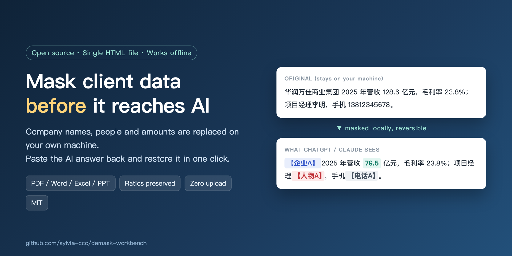
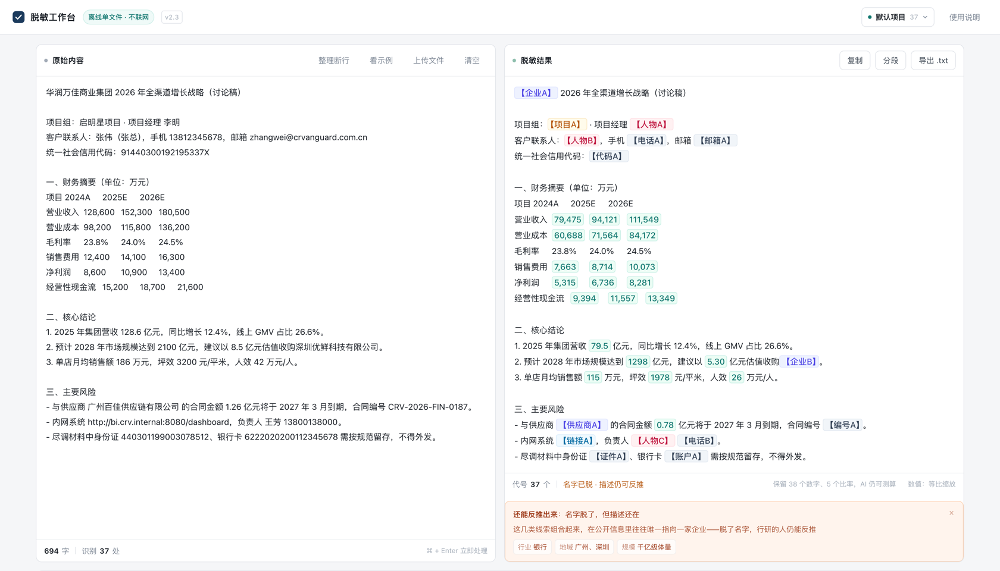

# Demask Workbench — mask client data before it reaches AI

<p align="center"></p>

<p align="center">
<a href="https://sylvia-ccc.github.io/demask-workbench/?demo=1"><b>▶ Try the demo (10 s)</b></a> ·
<a href="https://github.com/sylvia-ccc/demask-workbench/releases/latest"><b>⬇ Download the single file (< 400 KB)</b></a> ·
<a href="https://huggingface.co/spaces/sylviacccyu/demask-workbench">🤗 Hugging Face</a> ·
<a href="README.md">中文</a>
</p>

<p align="center">


</p>

> **For consultants, bankers, PE/VC, equity research and corporate finance.**
> You want ChatGPT / Claude to analyse interview notes, a financial model or an annual report — but you can't send client names and real figures.
> Drop the file in: **companies, people and project codes become `【企业A】`-style tokens, amounts are scaled by one hidden factor (ratios and growth rates are unchanged, so the AI can still do the math)**, and the AI's answer restores to real names and numbers in one click.
> Everything runs in your own browser. **No server, no network, no install** — one HTML file under 400 KB. Chinese-first (Chinese entity recognition), English entities supported.

| | |
|---|---|
| 🔒 **Never leaves your machine** | A built-in CSP blocks every network request at the browser level; works offline; zero dependencies, easy to audit |
| 📄 **Drop in PDFs** | Annual reports and prospectuses (500 pages in under a second); table columns and line-wrapped company names are reconstructed |
| 🧮 **The AI can still calculate** | Proportional scaling keeps margins, growth and shares exact — not just redaction |
| ↩️ **Reversible** | Tokens survive LLM rewriting (brackets dropped, bold, spacing); units are checked on restore |
| 🧪 **Published numbers** | Sealed blind test on 100 real annual-report / prospectus / consulting passages: F1 80.5%; every release independently reviewed |



---

## New in v2.5

16 more identifier types (card CVV and expiry, security answers, residence permits, login names, policy numbers, MAC / IMEI / VIN, court case numbers, penalty notices, property certificates, ISIN / LEI / private fund codes — checksums verified where they exist); optional reversible **date shifting** (all full dates move by one hidden offset, intervals preserved); a **compliance log** that records every copy / export with type counts and a SHA-256 fingerprint of what was sent, never the content; and **rule packs** to share client lists and custom rules with your team (optionally passphrase-encrypted).

## New in v2.4: nothing left in the corners of Office files

Masking the body text is not enough: Word stores the author, reviewers and deleted revisions; PowerPoint charts carry an embedded Excel with the raw numbers; Excel sheets are named after the client; the file name itself says "ClientX DD report.docx". v2.4 cleans document properties, comments and reviewer names, tracked deletions, headers/footers, alt text, chart caches and embedded workbooks (scaled consistently), sheet names (formulas updated), formula caches, pivot caches, hyperlinks, thumbnails and the exported file name — and lists what it cleaned. It also recognises speakers in meeting minutes and chat logs, and scales amounts written in Chinese numerals.

## New in v2.3: drop in a PDF

Annual reports, prospectuses and broker research are mostly PDFs. Drop one in and the text layer is extracted locally (zero dependencies, no network). Table columns are kept as tab-separated cells, wrapped lines are re-joined, and company names broken across lines are still recognised as one entity. Copy-protected PDFs (owner password only) are supported; PDFs with an open password and fully scanned PDFs are rejected with a clear message, and scanned pages inside a text PDF are reported by page number. Tested on 8 annual reports and prospectuses (143–510 pages): under 1 second each, at most 0.01% missing characters compared with pdftotext. Output is masked plain text (.txt).

## The problem

A consultant's daily reality: you have interview notes, a financial model, a draft deal structure.
You want to ask an LLM about them. But you can't — the material contains client names, project
codes, real revenue figures.

So you either paste it anyway (risk), spend an hour scrubbing it by hand (waste), or skip the AI
entirely (opportunity cost).

Existing tools don't solve this, because their assumptions don't match:

| | They assume | Your reality |
|---|---|---|
| **Where the data lives** | Databases, warehouses | Your clipboard |
| **What's sensitive** | SSNs, credit cards, phone numbers | Client names, project codes, deal amounts |
| **Direction** | Irreversible (static masking) | Must be reversible, or the AI's answer is useless |
| **Numbers** | Mask to `***` | Masked = AI can't analyse; unmasked = leak |

That's why enterprise DLP platforms, Presidio-style frameworks and AI gateways all miss this
use case. **The data isn't in a database — it's in a partner's clipboard.**

---

## Four design decisions

### 1. Amounts scale proportionally; ratios stay exact

Replacing the company name isn't enough. This paragraph is still unsafe:

> A dairy company in East China, FY2025 revenue **¥12.86B**, online share **26.6%**, **1,240** stores.

Four or five numbers together form a fingerprint. An industry analyst can reverse it in minutes.
These are **quasi-identifiers**.

So amounts are scaled by a single factor (default ×0.618, randomised per session) while **every
ratio stays identical**:

```
Before: FY2025 revenue ¥12.86B, online GMV ¥3.42B, share 26.6%
After:  FY2025 revenue ¥ 7.95B, online GMV ¥2.11B, share 26.6%
```

The AI can still compute CAGR, run sensitivity analysis, decompose drivers — but the absolute
numbers no longer point at a specific company.

### 2. Reversible tokens that survive LLM rewriting

```
You send:  The target is 【标的A】, advised by 【顾问A】, revenue ¥7.95B.
AI says:   Based on 标的A's data, revenue is about 7.95B, advised by 【顾问 A】.
```

Bracket dropped, space added, markdown bold, half-width brackets — all restore correctly.

Restoration validates **units**: `79.5%` will never be restored as `128.6%`. (The AI was talking
about a margin; stuffing revenue in there would silently corrupt the conclusion.)

### 3. Re-identification risk, not just "did we catch the phone number"


After masking, the status bar doesn't say "all clear". It says:

> **Name removed · description still identifiable**
> Industry: dairy · Region: East China · Scale: ¥10B+ · Structure: 1,240 stores, 8.2% share

The tool won't delete those descriptors for you (the AI needs them), but it tells you exactly how
much is left.

**The goal isn't replacing names — it's reducing identifiability.**

### 4. One mapping table per client

Shared mapping tables cause three problems: token indices creep up (the tenth project starts at
`【企业J】`), exporting the mapping leaks every past client, and cross-project restoration can
silently swap in the wrong name.

Now each project has its own table, tokens restart at A, and exports contain only the current
project. If you paste content from another project, the tool tells you which one it belongs to.

---

## Features

| | |
|---|---|
| **Input** | Paste, drag & drop, `.docx` / `.xlsx` / `.pptx` / `.txt` / `.md` / `.csv`, up to 20 files at once |
| **Detects** | 20+ entity types: organisations, people, project codes, amounts, equity percentages, phones, emails, national IDs, bank accounts, addresses, URLs, tickers, contract/invoice numbers, API keys |
| **Lexicon** | 674 Chinese company short names across 9 industries, plus international firms (Goldman Sachs, KKR, McKinsey, BlackRock) |
| **Tables** | Tab / comma / pipe / multi-space delimited; column semantics inferred from header or row labels |
| **Output** | Token mode (reversible) or mask mode (`华润***`, irreversible) |
| **Export** | Word / Excel / PPT with original formatting preserved; batch mode packs a zip |
| **Restore** | Multi-turn accumulation, highlighted diffs, one-click copy-all |
| **Safety** | Fully local, zero network, AES-256-GCM mapping encryption, fail-closed copy guard, metadata-only audit log |

---

## Quick start

```bash
# Just use it
open 脱敏工作台.html      # macOS
start 脱敏工作台.html     # Windows

# Or build from source
cd src
python3 build.py         # inlines engine.js + lexicon.js + ui.html into one HTML
```

Requires Chrome / Edge 90+ or Safari 16.4+. Doesn't work on mobile (WeChat's in-app browser
can't run local files).

---

## How it works

### Zero dependencies

ZIP read/write, Office parsing, encryption, the detection engine and the UI are all hand-written:

| Capability | Implementation |
|---|---|
| Unpack docx/xlsx/pptx | Own ZIP central-directory parser + `DecompressionStream('deflate-raw')` |
| Pack docx/xlsx/pptx | Own CRC32 + local header / central directory / EOCD assembly |
| Encrypt mapping table | Web Crypto: PBKDF2-SHA256 (120k iterations) → AES-256-GCM |
| Detection engine | ~1,900 lines: regex + lexicon + role inference + same-name propagation + numeric scaling |

214 KB total, works offline.

### Why paragraph-level replacement

Word splits a single word across multiple runs:

```xml
<w:r><w:t>深圳优鲜</w:t></w:r>
<w:r><w:t>科技有限公司</w:t></w:r>
```

Replacing node by node, neither fragment looks like a company name — **both get missed**. So the
paragraph is reassembled, masked, then written back into the first run. The cost is losing
intra-paragraph formatting (one bold word). **Between missing data and losing formatting, always
choose missing formatting.**

### How table columns are identified

Numbers in Excel and Word tables have no units and no context — pure text rules catch nothing.

Two table shapes are handled:

- **Header row**: `Item | 2024A | 2025E` + `Revenue | 128,600 | 152,300`
- **Label row**: `Revenue | 128,600`

Header cells identify amount columns, plus a per-row check on whether the first cell is a financial
line item. Result:

| | Before | After |
|---|---|---|
| Revenue | 128,600 / 152,300 | 82,175 / 97,320 |
| COGS | 98,200 / 115,800 | 62,750 / 73,996 |
| **Store count** | 1,240 / 1,500 | **1,240 / 1,500** ← untouched |

Store counts staying put is the proof that column semantics work.

---

## Evaluation

```bash
cd src
node eval.js testset.json            # regression (106 positives)
node eval.js testset-holdout.json    # holdout (73)
node eval.js testset-blind.json      # blind (78)
node score.js                        # scorecard
node bench.js                        # performance
node test.js                         # 6 end-to-end scenarios
```

| Metric | Result |
|---|---|
| Precision | 100% (blind set, 78 positives) |
| Recall | 100% |
| Scorecard | **98.3 / 100** |
| 100k chars | 37 ms |
| 1M chars | 899 ms |

> **⚠️ The 100% is not trustworthy.** All three test sets were used during tuning. Validate with
> your own documents — run a report you've already delivered and count what's missed.
>
> For reference: the open-source `bert-small-pii-detection` model reports F1 0.87 on its own test
> set, and noticeably worse on unseen data. Any masking tool claiming 100% is lying.

---

## Known limitations

| Limitation | Why | Workaround |
|---|---|---|
| **Scanned / image PDFs** | No high-quality Chinese OCR in the browser; WASM would push the file from 214 KB to 5 MB+ | OCR first |
| **Excel formula cells** | Cached values get recalculated on open | Convert formulas to values first |
| **Intra-paragraph formatting** | Inherent to paragraph-level replacement | Re-format after export |
| **PDF line breaks** | `pdftotext` splits company names mid-word | Click "整理断行" (the tool detects and prompts) |
| **English personal names** | High false-positive rate without context | Only detected when preceded by a title/verb |
| **Cross-document disambiguation** | Two "China Resources" entities can't be told apart | Project isolation + manual review |

**Reversible masking is pseudonymisation, not anonymisation.** Under China's PIPL (Art. 73),
reversible processing still counts as personal information and remains regulated. The value is
substantially lower breach risk — not exemption from oversight.

---

## Repo layout

```
.
├── 脱敏工作台.html          # the product (214 KB, double-click to run)
├── index.html              # same file, entry point for GitHub Pages
├── src/
│   ├── engine.js           # detection, transformation, restoration, Office I/O
│   ├── lexicon.js          # 674 company names + 181 weak terms + 85 allow-list terms
│   ├── ui.html             # interface (with /*__ENGINE__*/ placeholder)
│   ├── build.py            # inline everything into one HTML
│   ├── test.js             # 6 end-to-end scenarios
│   ├── eval.js             # P/R/F1 evaluation
│   ├── score.js            # scorecard
│   ├── bench.js            # performance benchmark
│   ├── smoke.py            # browser smoke test
│   └── testset*.json       # three annotated test sets (257 cases)
├── docs/                   # scorecard, capability assessment, market research
└── assets/                 # screenshots
```

---

## License

MIT.

---

<details>
<summary>中文摘要</summary>

**脱敏工作台** —— 给咨询、投融资、财务场景做的本地数据脱敏工具。

把客户访谈纪要、财务模型、尽调材料粘给 AI 之前，先把客户名、项目代号、真实金额替换掉；
AI 的回答贴回来，一键还原。

四个不常见的设计：

1. **金额等比缩放** —— 同一比例缩放，比率分毫不变。AI 照样能测算，但绝对值不再是公司指纹。
2. **可逆代号** —— 兼容 AI 的各种改写（去括号、加空格、markdown、半角括号），还原时校验单位。
3. **再识别风险** —— 脱了名字还会告诉你"行业+地域+规模+结构"这几项组合起来仍可反推。
4. **项目隔离** —— 一客户一套映射，代号从 A 重新开始。

零依赖，214 KB，断网可用。详细说明见 [README.md](README.md)。

</details>
