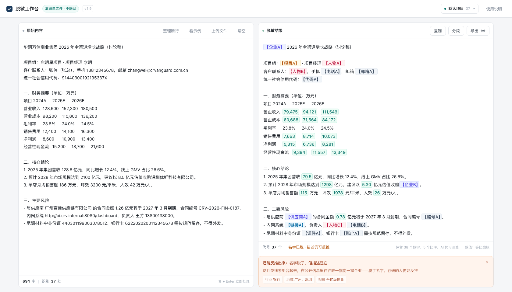
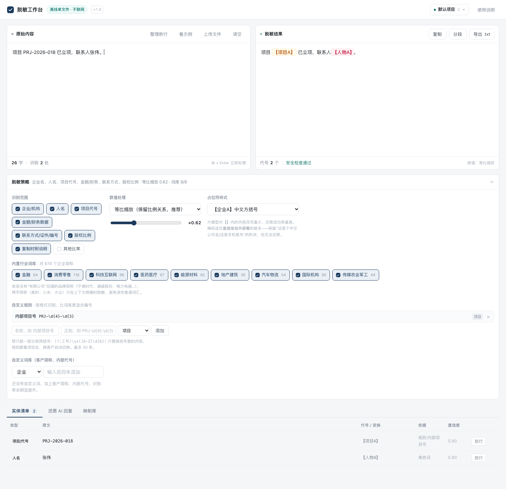

# 脱敏工作台 · Demask Workbench

> **咨询 / 投融资 / 财务场景的数据脱敏工具。**
> 把客户访谈纪要、财务模型、尽调材料、交易文件安全地粘给 ChatGPT / Claude / 豆包 / Kimi——
> **不泄露客户名、项目代号和真实金额**，AI 拿到的答案贴回来还能一键还原。

<p>


<a href="https://sylvia-ccc.github.io/demask-workbench/"></a>
</p>

**[→ 在线试用](https://sylvia-ccc.github.io/demask-workbench/)**（建议只用于试，正式用请下载本地文件）· [English](README.en.md)


---

## 什么时候用得上

如果你在做这些事，这个工具就是为你做的：

| 场景 | 你会怎么做 |
|---|---|
| **客户访谈纪要** | 录音转文字后想让 AI 提炼要点，但里面有客户高管姓名和门店数据 |
| **财务模型 / 三表** | 想让 AI 帮忙检查勾稽关系、做敏感性分析，但营收和利润是真实数字 |
| **尽调报告 / 投资备忘录（IM）** | 想让 AI 帮你搭框架、润色，但标的公司名字不能出现 |
| **交易结构设计** | 想把股权结构、对价、条款发给 AI 问风险，但买方卖方都是真实客户 |
| **行业研究报告** | 想让 AI 补充行业数据、对比竞品，但手上的份额和价格是付费调研的 |
| **培训课件 / 案例** | 想用真实案例讲课，但不能暴露客户 |
| **投委会材料** | 想让 AI 帮忙预演可能的质疑点，但材料是保密的 |

**共同点**：材料里有真实主体和真实数字，但你需要 AI 的理解能力，而不是它的记忆。

---

## 三步上手

```
1. 打开 → 粘贴材料      （支持 Word / Excel / PPT 直接拖入）
2. 扫一眼实体清单        （误伤的按「放行」，漏掉的加进词库）
3. 复制右侧脱敏稿 → 粘给 AI
```

AI 回答贴回「还原」页，客户名和原始金额自动换回来。



---

## 它解决的不是"脱敏"，是"敢把材料粘给 AI"

一个顾问的日常：客户访谈纪要、财务模型、交易结构草稿，想丢给 ChatGPT 问个问题，但不敢。

于是要么不脱敏直接发（风险），要么手动改一遍（一小时没了），要么干脆不用 AI（效率损失）。

市面上的工具解决不了这件事，因为它们的假设和你的场景对不上：

| | 它们假设 | 你的实际情况 |
|---|---|---|
| **数据位置** | 在数据库、数据仓库里 | 在剪贴板里 |
| **敏感实体** | 身份证、银行卡、手机号 | 客户名、项目代号、交易金额 |
| **脱敏方向** | 不可逆（静态脱敏） | 必须能还原，否则 AI 的回答没法用 |
| **数值处理** | 抹成 `***` | 抹了 AI 就没法算，不抹又怕泄露 |

这四条错配，导致商用 DLP 平台、Presidio 这类开源框架、AI 网关，没有一个是为你这个场景做的。

---

## 四个不常见的设计

### 一、金额等比缩放，比率一动不动

这是整个工具最核心的一个决定。

把公司名换成【企业A】，这段文字仍然不安全：

> 某华东区域乳制品企业，2025 年营收 **128.6 亿**，线上占比 **26.6%**，门店 **1,240** 家。

四五个数字的组合就是指纹，行研的人三分钟能反推。这叫**准标识符**。

所以金额不能只替换，必须**同时改变绝对值、保持相对关系**：

```
原文：2025年营收 128.6 亿元，线上 GMV 34.2 亿元，占比 26.6%
脱敏：2025年营收  79.5 亿元，线上 GMV 21.1 亿元，占比 26.6%
```

所有金额按同一比例（默认 ×0.618，每会话随机）缩放，**比率分毫不变**。AI 照样能算 CAGR、做敏感性分析、拆驱动因素，但绝对值不再是真实数字。

同一个数的不同写法（`128.6` / `128.60`）会得到同一个结果——否则 AI 会当成两个数，算增长率直接错。

### 二、代号能还原，且兼容 AI 的各种改写

```
你发出：  标的公司为【标的A】，由【顾问A】担任财务顾问，营收 79.5 亿元。
AI 回你： 根据标的A的数据，营收约79.5亿元，建议由【顾问 A】牵头。
```

去掉括号、加空格、markdown 加粗、换成半角方括号——都能还原。

还原时会校验**单位**：`79.5%` 不会被还原成 `128.6%`（AI 明明在说毛利率，你却把营收塞进去，结论就错了）。

### 三、脱了名字，还要告诉你"描述仍可反推"

这是和大多数工具最不一样的地方。


脱敏后状态栏不是简单的一句"安全检查通过"，而是：

> **名字已脱 · 描述仍可反推**
> 行业 乳制品 · 地域 华东 · 规模 百亿级体量 · 结构特征 1,240 家门店、8.2% 市占率

工具不会替你删这些描述（删了 AI 就读不懂），但会明确告诉你还剩多少线索。

**脱敏的目标不是替换名字，是降低可识别性。** 前者是动作，后者才是目的。

### 四、一个客户一套映射

所有项目共用一个映射库，会出三个问题：

1. 代号越编越靠后——做到第十个项目，第一个实体已经是【企业J】
2. 导出映射给同事协作，等于把**过去所有客户名单**一起发出去
3. 跨项目还原串号——A 项目的稿在 B 项目还原，可能变成另一个客户的名字

现在按项目隔离：新建项目代号从 A 重新开始，映射互不影响，导出的映射只含当前项目。

还加了一道防错——因为隔离之后"忘切项目"是必然发生的：

> 有 2 个代号没还原：【标的A】【人物A】
> 这段内容看起来属于项目「华润万佳-全渠道增长」（能还原 2 个）。**切过去并重新还原**

---

## 功能一览

| | |
|---|---|
| **输入** | 粘贴、拖拽、`.docx` / `.xlsx` / `.pptx` / `.txt` / `.md` / `.csv`，一次最多 20 个文件 |
| **识别** | 20+ 类实体：机构、人名、项目代号、金额、股权比例、手机/座机、邮箱、身份证、银行卡、统一社会信用代码、地址、网址、股票代码、合同/发票编号、密钥 |
| **词库** | 9 个行业、674 个企业简称，含国际机构（高盛、KKR、麦肯锡、金杜、Goldman Sachs） |
| **表格** | 支持制表符、逗号、竖线、多空格四种分隔；按表头或科目行判断"哪一列是金额" |
| **输出** | 代号模式（可还原）/ 掩码模式（华润\*\*\*，不可还原） |
| **交付** | 导出保留原格式的 Word / Excel / PPT；批量打包 zip |
| **还原** | 多轮累积，每轮追加进记录，最后一次性复制；还原部分高亮 |
| **项目** | 一客户一套映射，代号从 A 重新开始，规则和词库跟着走 |
| **安全** | 纯本地、零外链、映射表 AES-256-GCM 加密、复制前残留拦截、操作审计（仅元数据） |



---

## 快速开始

```bash
# 方式一：直接用成品
open 脱敏工作台.html          # macOS
start 脱敏工作台.html         # Windows

# 方式二：从源码构建
cd src
python3 ../build.py           # 内联 engine.js + lexicon.js + ui.html → 单个 HTML
```

打开后点「看示例」，30 秒就能看懂。

**浏览器要求**：Chrome / Edge 90+，Safari 16.4+。手机上打不开（微信内置浏览器跑不了本地文件）。

---

## 它是怎么做到的

### 零依赖

引擎、界面、Office 解析、加密、ZIP 读写全部手写，没有任何第三方库：

| 能力 | 实现 |
|---|---|
| 解 docx / xlsx / pptx | 自己解析 ZIP 中央目录 + `DecompressionStream('deflate-raw')` |
| 写 docx / xlsx / pptx | 自己算 CRC32 + 拼 ZIP 本地头/中央目录/EOCD |
| 映射表加密 | Web Crypto：PBKDF2-SHA256（12 万次迭代）→ AES-256-GCM |
| 脱敏引擎 | 正则 + 词库 + 角色识别 + 同名扩散 + 数值缩放，约 1900 行 |

整个工具 213 KB，断网可用。

### 为什么是"段落级"替换

Word 会把一个词拆成多个 run：

```xml
<w:r><w:t>深圳优鲜</w:t></w:r>
<w:r><w:t>科技有限公司</w:t></w:r>
```

逐节点替换，这两个片段各自都不构成公司名，**全都漏**。所以只能把整段文字拼起来脱敏，再写回第一个节点——代价是段内局部格式（某个词加粗）会丢，换来的是不漏。

**在不漏和好看之间，永远选不漏。**

### 表格怎么判断"哪一列是金额"

Excel 和 Word 表格里的数字没有单位、没有语境，纯文本规则一个都抓不到。

所以按两种表结构分别处理：

- **表头型**：`项目 | 2024A | 2025E` + `营业收入 | 128,600 | 152,300`
- **科目行型**：`营业收入 | 128,600`

表头判定金额列，同时逐行判断"首格是不是财务科目"。实测结果：

| | 原文 | 脱敏后 |
|---|---|---|
| 营业收入 | 128,600 / 152,300 | 82,175 / 97,320 |
| 营业成本 | 98,200 / 115,800 | 62,750 / 73,996 |
| **门店数** | 1,240 / 1,500 | **1,240 / 1,500** ← 不动 |

门店数不动是关键——说明列判定认得出"哪一列是金额"。

---

## 评测

不用"我觉得准"来判断，用带标注的测试集跑：

```bash
cd src
node eval.js testset.json            # 基础回归（106 正例）
node eval.js testset-holdout.json    # 留出验证（73 正例）
node eval.js testset-blind.json      # 盲测（78 正例）
node score.js                        # 评分卡
node bench.js                        # 性能压测
node test.js                         # 端到端 6 个场景
```

| 指标 | 结果 |
|---|---|
| Precision | 100%（盲测，78 正例） |
| Recall | 100% |
| 能力评分 | **98.3 / 100** |
| 10 万字耗时 | 37 ms |
| 100 万字耗时 | 899 ms |

评分卡（100 分）：识别质量 45 · 场景覆盖 20 · 工作流闭环 20 · 安全 10 · 可用性 5。

> **⚠️ 100% 不可采信。** 三份测试集都参与过调优。真实泛化能力请用你自己的文档验证——拿一份已交付的报告跑一遍，数一下漏了几个。
>
> 参考：开源 PII 模型 `bert-small-pii-detection` 自测 F1 0.87，换到没见过的外部数据集明显下降。任何声称 100% 的脱敏工具都在骗人。

详细评测见 [`docs/评分报告.html`](docs/评分报告.html)，能力边界见 [`docs/能力评估.html`](docs/能力评估.html)。

---

## 和同类工具的关系

不是"比它们强"，是**解决的不是同一个问题**。

| | 商用 DLP / 脱敏平台 | Presidio 等开源框架 | 本工具 |
|---|---|---|---|
| 部署 | 服务器 / Agent，交付以月计 | 需要 Python 环境 | 单个 HTML |
| 数据流向 | 本地或私有云，需运维 | 本地，要装依赖 | 浏览器内存 |
| 实体重心 | 个人信息（证件、账号） | 欧美证件为主 | 中文机构 / 人名 / 财务数字 |
| 可逆性 | 不可逆 | 不可逆 | 可逆，兼容 AI 改写 |
| 数值处理 | 掩码 / 置空 | 掩码 | 等比缩放，保留比率 |
| 审计权限 | 完善 | 无 | 轻量（仅元数据） |
| 库表批量 | 强 | 中 | 最多 20 文件 |

商用平台的假设是"数据在数据库和系统里"，本工具的假设是"数据在顾问的剪贴板里"。前者能管住全公司，但覆盖不到一个人在网页版 AI 里粘贴一段访谈纪要——**而那正是最容易出事的地方**。

设计上借鉴了几个开源项目的思路（ARX 的再识别风险量化、Presidio 的识别与变换分离、Greenmask 的确定性、privacy-filter 的 fail-closed），但**没有使用任何它们的代码**。

---

## 已知局限

诚实列出来，不掩饰：

| 局限 | 原因 | 怎么办 |
|---|---|---|
| **扫描件 / 图片 PDF** | 浏览器里做不了高质量中文 OCR，引入 WASM 会让文件从 213KB 涨到 5MB+ | 先 OCR 再处理 |
| **Excel 公式单元格** | 改了缓存值，Excel 一打开就重算回真实数 | 先把公式转成数值 |
| **Word 段内局部格式** | 段落级替换的必然代价 | 导出后手工调格式 |
| **PDF 断行** | `pdftotext` 会把公司名切成两半 | 点「整理断行」，工具会自动检测并提示 |
| **英文人名** | 无上下文的英文名误伤率高 | 只在有称谓/动词引导时识别 |
| **跨文档实体消歧** | 两家"华润"系公司分不开 | 靠项目隔离 + 人工核对 |
| **映射表是明文索引** | 谁的电脑被拿到，谁就能还原历史 | 可设口令加密；项目结束就清空 |

**可逆脱敏在法律上属于"去标识化"，不是"匿名化"。** 按《个人信息保护法》第 73 条，可还原的处理仍属个人信息、仍受监管。它的价值是显著降低泄露风险与责任，不是"从此不受管"。

---

## 目录结构

```
.
├── 脱敏工作台.html          # 成品，双击即用（213 KB）
├── src/
│   ├── engine.js            # 脱敏引擎：识别、变换、还原、文件解析
│   ├── lexicon.js           # 行业词库：674 个企业简称 + 181 个两字词 + 85 个白名单
│   ├── ui.html              # 界面（含 /*__ENGINE__*/ 占位符）
│   ├── build.py             # 打包成单文件
│   ├── test.js              # 端到端 6 个场景
│   ├── eval.js              # 评测脚本（P/R/F1）
│   ├── score.js             # 评分卡
│   ├── bench.js             # 性能压测
│   ├── smoke.py             # 浏览器冒烟测试
│   └── testset*.json        # 三份带标注测试集（257 用例）
├── docs/
│   ├── 评分报告.html         # 评分依据与对标
│   └── 能力评估.html         # 能力边界
└── assets/                  # 截图
```

---

## License

MIT。用、改、发都行，出问题别找我。

---

<details>
<summary>English summary</summary>

**Demask Workbench** — a single-file, offline data-masking tool for consultants, investors and finance professionals who need to paste material into an LLM without leaking client data.

Open the HTML file, paste your document, get a masked version you can send to ChatGPT / Claude / any AI. Paste the AI's answer back and it restores the real names and amounts.

**What makes it different**

- **Proportional scaling of amounts.** All figures are scaled by the same factor, so ratios, margins and growth rates stay intact — the AI can still do real analysis, but the absolute numbers no longer fingerprint the company.
- **Reversible tokens that survive LLM rewriting.** `【标的A】`, `标的A`, `【标的 A】`, `**[标的A]**`, `[标的A]` all restore correctly. Unit checks prevent `79.5%` from being restored as `128.6%`.
- **Re-identification risk scoring.** After masking, it tells you what's *still* identifiable — industry + region + scale + structural features can uniquely point to one company even without a name.
- **Project isolation.** One mapping table per client; tokens restart at A; exported mappings contain only the current project.

**Zero dependencies.** ZIP read/write, docx/xlsx/pptx parsing, PBKDF2 + AES-256-GCM encryption, the detection engine and the UI are all hand-written. 213 KB total, works offline.

**Evaluation:** 257 annotated test cases across three sets, 98.3/100 on a reproducible scorecard. The 100% detection rate is **not** trustworthy — all three sets were used during tuning. Verify with your own documents.

MIT licensed.

</details>
