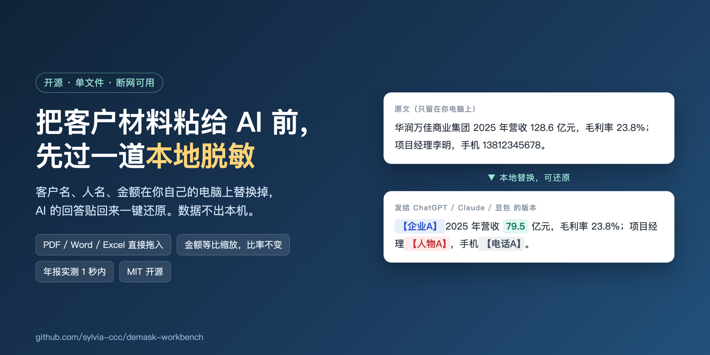
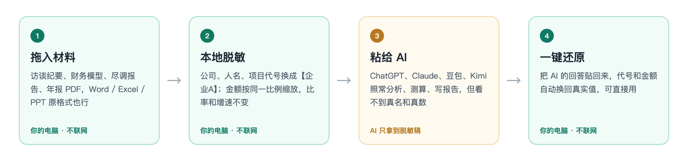
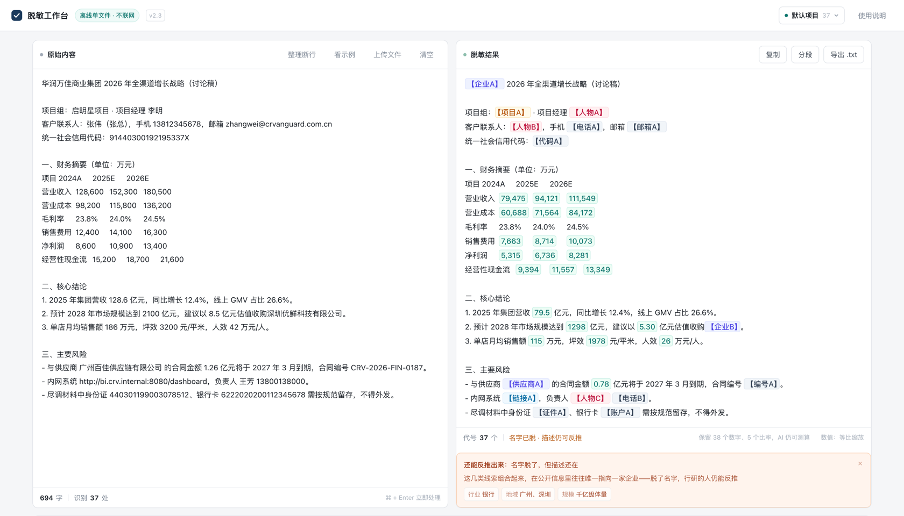
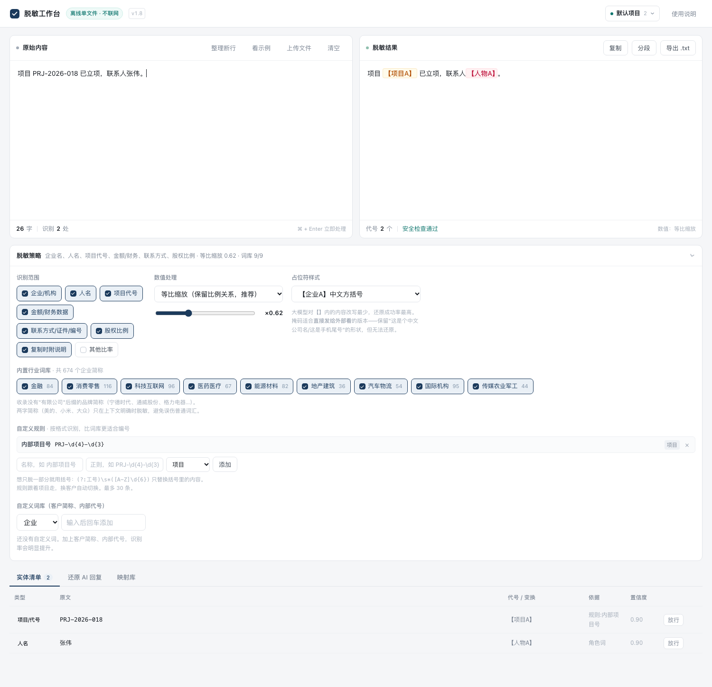

# 脱敏工作台 · 把客户材料粘给 AI 前，先本地脱敏

<p align="center"></p>

<p align="center">
<a href="https://sylvia-ccc.github.io/demask-workbench/?demo=1"><b>▶ 在线看示例（10 秒）</b></a> ·
<a href="https://github.com/sylvia-ccc/demask-workbench/releases/latest"><b>⬇ 下载单文件（344 KB）</b></a> ·
<a href="https://huggingface.co/spaces/sylviacccyu/demask-workbench">🤗 Hugging Face</a> ·
<a href="README.en.md">English</a>
</p>

<p align="center">


</p>

> **给咨询、投行、PE/VC、券商研究、企业财务的人用的。**
> 访谈纪要、财务模型、尽调报告、年报 PDF——想让 ChatGPT / Claude / 豆包 / Kimi 帮忙分析，又不能把客户名和真实数字发出去？
> 拖进来，**客户名、人名、项目代号换成【企业A】，金额按同一比例缩放（比率、增速不变，AI 照样能算）**，AI 的回答贴回来一键换回真名真数。
> 整个过程在你自己的浏览器里完成，**没有服务器、不联网、不用安装**，一个 344 KB 的 HTML 文件。

<p align="center"></p>

### 为什么值得一试

| | |
|---|---|
| 🔒 **真的不出本机** | 页面内置 CSP，浏览器层面拦截一切网络请求；可以断网用，也可以自己审代码（零依赖） |
| 📄 **年报 PDF 直接拖** | 招股书、年报、研报读文字层，500 页 1 秒内；表格列、折行公司名都能还原 |
| 🧮 **AI 还能算** | 金额等比缩放，毛利率、增速、占比分毫不变；不是简单打码 |
| ↩️ **能还原** | 代号兼容 AI 的各种改写（去括号、加粗、加空格），还原时校验单位 |
| 🧪 **数字公开可查** | 100 例真实年报 / 招股书 / 咨询文体封存盲测，F1 80.5%；每个版本都有独立核查 |



---

## 什么时候用得上

如果你在做这些事，这个工具就是为你做的：

| 场景 | 你会怎么做 |
|---|---|
| **客户访谈纪要** | 录音转文字后想让 AI 提炼要点，但里面有客户高管姓名和门店数据 |
| **财务模型 / 三表** | 想让 AI 帮忙检查勾稽关系、做敏感性分析，但营收和利润是真实数字 |
| **尽调报告 / 投资备忘录（IM）** | 想让 AI 帮你搭框架、润色，但标的公司名字不能出现 |
| **交易结构设计** | 想把股权结构、对价、条款发给 AI 问风险，但买方卖方都是真实客户 |
| **行业研究报告** | 想让 AI 补充行业数据、对比竞品，但手上的份额和价格是付费调研的 |
| **培训课件 / 案例** | 想用真实案例讲课，但不能暴露客户 |
| **投委会材料** | 想让 AI 帮忙预演可能的质疑点，但材料是保密的 |

**共同点**：材料里有真实主体和真实数字，但你需要 AI 的理解能力，而不是它的记忆。

---

## 三步上手

```
1. 打开 → 粘贴材料      （支持 Word / Excel / PPT 直接拖入）
2. 扫一眼实体清单        （误伤的按「放行」，漏掉的加进词库）
3. 复制右侧脱敏稿 → 粘给 AI
```

AI 回答贴回「还原」页，客户名和原始金额自动换回来。

---

## 它解决的不是"脱敏"，是"敢把材料粘给 AI"

一个顾问的日常：客户访谈纪要、财务模型、交易结构草稿，想丢给 ChatGPT 问个问题，但不敢。

于是要么不脱敏直接发（风险），要么手动改一遍（一小时没了），要么干脆不用 AI（效率损失）。

市面上的工具解决不了这件事，因为它们的假设和你的场景对不上：

| | 它们假设 | 你的实际情况 |
|---|---|---|
| **数据位置** | 在数据库、数据仓库里 | 在剪贴板里 |
| **敏感实体** | 身份证、银行卡、手机号 | 客户名、项目代号、交易金额 |
| **脱敏方向** | 不可逆（静态脱敏） | 必须能还原，否则 AI 的回答没法用 |
| **数值处理** | 抹成 `***` | 抹了 AI 就没法算，不抹又怕泄露 |

这四条错配，导致商用 DLP 平台、Presidio 这类开源框架、AI 网关，没有一个是为你这个场景做的。

---

## 四个不常见的设计

### 一、金额等比缩放，比率一动不动

这是整个工具最核心的一个决定。

把公司名换成【企业A】，这段文字仍然不安全：

> 某华东区域乳制品企业，2025 年营收 **128.6 亿**，线上占比 **26.6%**，门店 **1,240** 家。

四五个数字的组合就是指纹，行研的人三分钟能反推。这叫**准标识符**。

所以金额不能只替换，必须**同时改变绝对值、保持相对关系**：

```
原文：2025年营收 128.6 亿元，线上 GMV 34.2 亿元，占比 26.6%
脱敏：2025年营收  79.5 亿元，线上 GMV 21.1 亿元，占比 26.6%
```

所有金额按同一比例（默认 ×0.618，每会话随机）缩放，**比率分毫不变**。AI 照样能算 CAGR、做敏感性分析、拆驱动因素，但绝对值不再是真实数字。

同一个数的不同写法（`128.6` / `128.60`）会得到同一个结果——否则 AI 会当成两个数，算增长率直接错。

### 二、代号能还原，且兼容 AI 的各种改写

```
你发出：  标的公司为【标的A】，由【顾问A】担任财务顾问，营收 79.5 亿元。
AI 回你： 根据标的A的数据，营收约79.5亿元，建议由【顾问 A】牵头。
```

去掉括号、加空格、markdown 加粗、换成半角方括号——都能还原。

还原时会校验**单位**：`79.5%` 不会被还原成 `128.6%`（AI 明明在说毛利率，你却把营收塞进去，结论就错了）。

### 三、脱了名字，还要告诉你"描述仍可反推"

这是和大多数工具最不一样的地方。

脱敏后状态栏不是简单的一句"安全检查通过"，而是：

> **名字已脱 · 描述仍可反推**
> 行业 乳制品 · 地域 华东 · 规模 百亿级体量 · 结构特征 1,240 家门店、8.2% 市占率

工具不会替你删这些描述（删了 AI 就读不懂），但会明确告诉你还剩多少线索。

**脱敏的目标不是替换名字，是降低可识别性。** 前者是动作，后者才是目的。

### 四、一个客户一套映射

所有项目共用一个映射库，会出三个问题：

1. 代号越编越靠后——做到第十个项目，第一个实体已经是【企业J】
2. 导出映射给同事协作，等于把**过去所有客户名单**一起发出去
3. 跨项目还原串号——A 项目的稿在 B 项目还原，可能变成另一个客户的名字

现在按项目隔离：新建项目代号从 A 重新开始，映射互不影响，导出的映射只含当前项目。

还加了一道防错——因为隔离之后"忘切项目"是必然发生的：

> 有 2 个代号没还原：【标的A】【人物A】
> 这段内容看起来属于项目「华润万佳-全渠道增长」（能还原 2 个）。**切过去并重新还原**

---

## 功能一览

| | |
|---|---|
| **输入** | 粘贴、拖拽、`.docx` / `.xlsx` / `.pptx` / `.txt` / `.md` / `.csv`，一次最多 20 个文件 |
| **识别** | 20+ 类实体：机构、人名、项目代号、金额、股权比例、手机/座机/国际电话、邮箱、身份证、银行卡、IBAN/SWIFT、证券账户/资金账号、统一社会信用代码、地址、网址、IP、股票代码（A 股/港股/美股）、合同/发票编号、密钥/密码、出生日期。完整清单见 [docs/脱敏规则清单.md](docs/脱敏规则清单.md) |
| **词库** | 9 个行业、674 个企业简称，含国际机构（高盛、KKR、麦肯锡、金杜、Goldman Sachs） |
| **表格** | 支持制表符、逗号、竖线、多空格四种分隔；按表头或科目行判断"哪一列是金额" |
| **输出** | 代号模式（可还原）/ 掩码模式（华润\*\*\*，不可还原） |
| **交付** | 导出保留原格式的 Word / Excel / PPT；批量打包 zip |
| **还原** | 多轮累积，每轮追加进记录，最后一次性复制；还原部分高亮 |
| **项目** | 一客户一套映射，代号从 A 重新开始，规则和词库跟着走 |
| **安全** | 纯本地、零外链、映射表 AES-256-GCM 加密、复制前残留拦截、操作审计（仅元数据） |



---

## 快速开始

```bash
# 方式一：直接用成品
open 脱敏工作台.html          # macOS
start 脱敏工作台.html         # Windows

# 方式二：从源码构建
cd src
python3 ../build.py           # 内联 engine.js + lexicon.js + ui.html → 单个 HTML
```

打开后点「看示例」，30 秒就能看懂。

**浏览器要求**：Chrome / Edge 90+，Safari 16.4+。手机上打不开（微信内置浏览器跑不了本地文件）。

---

## 它是怎么做到的

### 零依赖

引擎、界面、Office 解析、加密、ZIP 读写全部手写，没有任何第三方库：

| 能力 | 实现 |
|---|---|
| 解 docx / xlsx / pptx | 自己解析 ZIP 中央目录 + `DecompressionStream('deflate-raw')` |
| 写 docx / xlsx / pptx | 自己算 CRC32 + 拼 ZIP 本地头/中央目录/EOCD |
| 映射表加密 | Web Crypto：PBKDF2-SHA256（12 万次迭代）→ AES-256-GCM |
| 脱敏引擎 | 正则 + 词库 + 角色识别 + 同名扩散 + 数值缩放，约 1900 行 |

整个工具约 243 KB，断网可用。v2.0 起页面内置内容安全策略（CSP），浏览器会拦截一切网络请求，不联网由浏览器强制保证。

### 为什么是"段落级"替换

Word 会把一个词拆成多个 run：

```xml
<w:r><w:t>深圳优鲜</w:t></w:r>
<w:r><w:t>科技有限公司</w:t></w:r>
```

逐节点替换，这两个片段各自都不构成公司名，**全都漏**。所以只能把整段文字拼起来脱敏，再写回第一个节点——代价是段内局部格式（某个词加粗）会丢，换来的是不漏。

**在不漏和好看之间，永远选不漏。**

### 表格怎么判断"哪一列是金额"

Excel 和 Word 表格里的数字没有单位、没有语境，纯文本规则一个都抓不到。

所以按两种表结构分别处理：

- **表头型**：`项目 | 2024A | 2025E` + `营业收入 | 128,600 | 152,300`
- **科目行型**：`营业收入 | 128,600`

表头判定金额列，同时逐行判断"首格是不是财务科目"。实测结果：

| | 原文 | 脱敏后 |
|---|---|---|
| 营业收入 | 128,600 / 152,300 | 82,175 / 97,320 |
| 营业成本 | 98,200 / 115,800 | 62,750 / 73,996 |
| **门店数** | 1,240 / 1,500 | **1,240 / 1,500** ← 不动 |

门店数不动是关键——说明列判定认得出"哪一列是金额"。

---

## v2.3：直接拖入 PDF

年报、招股书、研报、尽调材料大多是 PDF。v2.3 起可以直接把 PDF 拖进来：

- 读取 PDF 自带的文字层，**不联网、不装任何东西**，仍是一个单文件
- 表格的列自动用制表符分开，金额列照常按表格识别和缩放
- 折行会尽量拼回；即使公司名被折成两行甚至几行，引擎也会跨行把它整体识别出来
- 研报常见的"禁止复制"加密（只设了权限密码）也能读；设了打开密码的、整份是扫描件的，会明确告诉你读不了；夹在中间的扫描页会提示页码
- 实测：8 份巨潮资讯网下载的年报和招股书（143–510 页），每份 1 秒内读完；与 pdftotext 对比，缺字率不超过 0.01%

PDF 只能导出为脱敏后的文本（.txt），不能生成脱敏后的 PDF。多栏排版和跨页表格的顺序可能和原文不同，正式使用前请看一眼实体清单和候选面板。

## v2.2：让人来补规则的短板

规则在机构简称上已经到顶（封存盲测 70%）。v2.2 把"拿不准"的部分交给使用者：

- **疑似实体一键确认**：实体清单上方列出"像客户名、像人名但没有被替换"的词，并写明理由。点一下就脱敏，点 × 表示不是。复制前，如果还有没确认的候选，会再提醒一次。
- **客户名单批量导入**：开始一个新项目时，先把客户、标的、交易对手的名单粘进来，或者导入 Excel。之后这个项目里的所有文档都按名单脱敏。

**建议的用法**：新项目第一步导入名单，再开始粘贴材料。

---

## 评测

不用"我觉得准"来判断，用带标注的测试集跑：

```bash
cd src
node eval.js testset-real-holdout.json   # ★ 真实文体盲测（50 例，调规则期间封存）
node eval.js testset-real-dev.json       # 真实文体开发集（50 例）
node eval.js testset.json                # 基础回归
node eval.js testset-holdout.json        # 留出验证
node eval.js testset-blind.json          # 自建盲测
node eval.js testset-rules-v2.json       # v2.0 每条新规则的正反例
node test.js                             # 端到端 6 个场景
node bench.js                            # 性能压测
```

### 真实文体评测（v2.0 新增，最该看的数字）

100 例、439 个实体：
- 48 例直接截自巨潮资讯网的 6 份 2024 年报和 2 份招股书，覆盖董监高、关联交易、前五名客户、股东情况。
- 其余是按真实文风写的访谈、纪要、邮件、研报、交易条款。

调规则时只看其中一半（开发集），另一半封存到最后才跑一次：

| 盲测（封存半，50 例） | 精确率 | 召回率 | F1 |
|---|---|---|---|
| v1.9 | 80.4% | 57.7% | 67.2% |
| v2.0 | 83.4% | 75.6% | 79.3% |
| **v2.1** | **83.3%** | **77.5%** | **80.3%** |

| 按类型召回（封存半） | v1.9 | v2.0 | v2.1 |
|---|---|---|---|
| 金额 | 56% | 96% | 96% |
| 人名 | 39% | 67% | 67% |
| 机构 | 63% | 65% | **70%** |
| 电话 / 邮箱 / 证件 / 股票代码等 | 86–100% | 100% | 100% |

**实话实说**：
- **机构简称仍是最大的短板（70%）**：没有后缀、上下文也没有提示的简称（如"安特尔""龙腾"），规则认不出来。工具会把疑似简称列成候选，点一下就能加入词库。正式使用前，请把客户和项目的简称先加进项目词库。
- 标注由 AI 完成并复核，没有经过人工核对。
- 开发半和封存半拆自同一批 8 份公开文件，所以封存半的数字是"同源留出"，在完全陌生的文档上可能更低。请用你自己的已交付文档再验证一遍。
- 自建的三份测试集仍是 100%，但它们都参与过调参，不能当泛化证据。

### 性能

| 字数 | v1.9 | v2.0 |
|---|---|---|
| 10 万 | 37 ms | 38 ms |
| 50 万 | 约 275 ms | 约 230 ms |
| 100 万 | 约 940 ms | 约 520 ms |
| 5 万个连续字母（极端输入） | 约 1.2 秒 | 6 ms |

完整规则见 [`docs/脱敏规则清单.md`](docs/脱敏规则清单.md)。
历史评测见 [`docs/评分报告.html`](docs/评分报告.html)、[`docs/实测报告.html`](docs/实测报告.html)。

---

## 和同类工具的关系

不是"比它们强"，是**解决的不是同一个问题**。

| | 商用 DLP / 脱敏平台 | Presidio 等开源框架 | 本工具 |
|---|---|---|---|
| 部署 | 服务器 / Agent，交付以月计 | 需要 Python 环境 | 单个 HTML |
| 数据流向 | 本地或私有云，需运维 | 本地，要装依赖 | 浏览器内存 |
| 实体重心 | 个人信息（证件、账号） | 欧美证件为主 | 中文机构 / 人名 / 财务数字 |
| 可逆性 | 不可逆 | 不可逆 | 可逆，兼容 AI 改写 |
| 数值处理 | 掩码 / 置空 | 掩码 | 等比缩放，保留比率 |
| 审计权限 | 完善 | 无 | 轻量（仅元数据） |
| 库表批量 | 强 | 中 | 最多 20 文件 |

商用平台的假设是"数据在数据库和系统里"，本工具的假设是"数据在顾问的剪贴板里"。前者能管住全公司，但覆盖不到一个人在网页版 AI 里粘贴一段访谈纪要——**而那正是最容易出事的地方**。

---

## 已知局限

诚实列出来，不掩饰：

| 局限 | 原因 | 怎么办 |
|---|---|---|
| **扫描件 / 图片 PDF** | 浏览器里做不了高质量中文 OCR，引入 WASM 会让文件从约 300KB 涨到 5MB+。有文字层的 PDF 可以直接拖入（v2.3） | 先 OCR 再处理 |
| **Excel 公式单元格** | 改了缓存值，Excel 一打开就重算回真实数 | 先把公式转成数值 |
| **Word 段内局部格式** | 段落级替换的必然代价 | 导出后手工调格式 |
| **PDF 版面** | 直接拖入 PDF 时会自动拼回折行；但多栏排版、跨页表格的顺序可能乱，表格单元格内的长名字偶尔仍会断开 | 看一眼实体清单和候选面板；从别处复制来的断行文本可点「整理断行」 |
| **英文人名** | 无上下文的英文名误伤率高 | 只在有称谓/动词引导时识别 |
| **跨文档实体消歧** | 两家"华润"系公司分不开 | 靠项目隔离 + 人工核对 |
| **映射表是明文索引** | 谁的电脑被拿到，谁就能还原历史 | 可设口令加密；项目结束就清空 |

**可逆脱敏在法律上属于"去标识化"，不是"匿名化"。** 按《个人信息保护法》第 73 条，可还原的处理仍属个人信息、仍受监管。它的价值是显著降低泄露风险与责任，不是"从此不受管"。

---

## 目录结构

```
.
├── 脱敏工作台.html          # 成品，双击即用（约 243 KB）
├── src/
│   ├── engine.js            # 脱敏引擎：识别、变换、还原、文件解析
│   ├── lexicon.js           # 行业词库：674 个企业简称 + 181 个两字词 + 85 个白名单
│   ├── ui.html              # 界面（含 /*__ENGINE__*/ 占位符）
│   ├── build.py             # 打包成单文件
│   ├── test.js              # 端到端 6 个场景
│   ├── eval.js              # 评测脚本（P/R/F1）
│   ├── score.js             # 评分卡
│   ├── bench.js             # 性能压测
│   ├── smoke.py             # 浏览器冒烟测试
│   └── testset*.json        # 三份带标注测试集（257 用例）
├── docs/
│   ├── 评分报告.html         # 评分依据与对标
│   └── 能力评估.html         # 能力边界
└── assets/                  # 截图
```

---

## License

MIT。用、改、发都行，出问题别找我。

---

<details>
<summary>English summary</summary>

**Demask Workbench** — a single-file, offline data-masking tool for consultants, investors and finance professionals who need to paste material into an LLM without leaking client data.

Open the HTML file, paste your document, get a masked version you can send to ChatGPT / Claude / any AI. Paste the AI's answer back and it restores the real names and amounts.

**What makes it different**

- **Proportional scaling of amounts.** All figures are scaled by the same factor, so ratios, margins and growth rates stay intact — the AI can still do real analysis, but the absolute numbers no longer fingerprint the company.
- **Reversible tokens that survive LLM rewriting.** `【标的A】`, `标的A`, `【标的 A】`, `**[标的A]**`, `[标的A]` all restore correctly. Unit checks prevent `79.5%` from being restored as `128.6%`.
- **Re-identification risk scoring.** After masking, it tells you what's *still* identifiable — industry + region + scale + structural features can uniquely point to one company even without a name.
- **Project isolation.** One mapping table per client; tokens restart at A; exported mappings contain only the current project.

**Zero dependencies.** ZIP read/write, docx/xlsx/pptx parsing, PBKDF2 + AES-256-GCM encryption, the detection engine and the UI are all hand-written. 213 KB total, works offline.

**Evaluation:** 257 annotated test cases across three sets, 98.3/100 on a reproducible scorecard. The 100% detection rate is **not** trustworthy — all three sets were used during tuning. Verify with your own documents.

MIT licensed.

</details>
